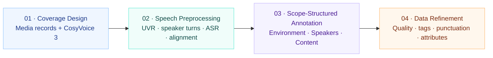

<div align="center">

<h1>VoxCaps</h1>
<p><strong>Data pipeline for VoxDirector</strong></p>

<p>
  
  
</p>

<p>
  <a href="https://voxdirector.github.io/">Audio demo</a>
  &nbsp;·&nbsp;
  <a href="docs/models.md">Models &amp; setup</a>
  &nbsp;·&nbsp;
  <a href="docs/paper_alignment.md">Paper settings</a>
  &nbsp;·&nbsp;
  <a href="docs/manifest.md">Manifest format</a>
</p>

</div>

VoxCaps prepares speech scenes for VoxDirector through the four stages described in the paper.

## Pipeline



| Stage | Processing | Code |
| :--- | :--- | :--- |
| **01 · Coverage Design** | Organize external media records and generate CosyVoice 3 speech from caller-supplied JSONL. | [Records](src/voxcaps/coverage_design/manifest.py) · [CosyVoice 3 synthesis](src/voxcaps/coverage_design/synthesis.py) |
| **02 · Speech Preprocessing** | Separate vocals, identify speaker turns, transcribe with Fun-ASR-Nano and SenseVoice, and align words with Qwen3-ForcedAligner. | [Models](src/voxcaps/speech_preprocessing/models.py) · [Segmentation](src/voxcaps/speech_preprocessing/segmentation.py) |
| **03 · Scope-Structured Annotation** | Annotate input audio with Qwen3.5-Omni, using our prompts and the media-specific style matrix. | [Inference](src/voxcaps/scope_annotation/provider.py) · [Prompts](src/voxcaps/scope_annotation/prompts.py) · [Style matrix](configs/03_scope_annotation/style_matrix.json) |
| **04 · Data Refinement** | Filter quality and duration, repair tags and punctuation, and extract gender, age, emotion and persona with supporting text. | [Refinement modules](src/voxcaps/data_refinement/) |

The original audio mixture supplies annotation and training; separated vocals support speaker analysis, transcription and alignment. CosyVoice 3 reading hints go to the teacher, while the student transcript keeps its original spelling.

[Stage runners](src/voxcaps/stages.py) connect the pipeline. Manual review and expressive-subset selection are outside this package.

## Quickstart

### 1. Install

Use Python 3.10 or later. Qwen3.5-Omni audio annotation uses the package's standard-library API client:

```bash
python -m pip install -e .
```

For local preprocessing and quality models:

```bash
python -m pip install -e '.[models]'
```

Stage 1 uses the [CosyVoice 3 environment and synthesis dependencies](docs/models.md#runtime-dependencies), installed separately.

### 2. Set up models and inputs

Follow [Models & setup](docs/models.md), then fill in the paths and endpoint in `configs/`. Qwen3.5-Omni uses a hosted streaming API and reads its key from the configured environment variable. The other models use downloaded weights. Input records use the [JSONL manifest format](docs/manifest.md).

### CosyVoice 3 generation

Supply your own JSONL with `id`, `student_text`, `reference_audio` and `reference_transcript`. Text, reference voices and optional pronunciation hints come from that file; see the [input fields](docs/manifest.md#synthesis-jobs).

```bash
voxcaps synthesize jobs.jsonl --output outputs/synthesis \
  --teacher-dir models/Fun-CosyVoice3-0.5B
```

This writes WAV files and `manifest.jsonl`. Paper subset labels are optional metadata supplied in the input.

### Qwen3.5-Omni audio annotation

Supply a JSONL containing `id` and `audio`. Optional `media_type`, `languages` and `transcript` fields guide the [audio prompt](src/voxcaps/scope_annotation/templates.py) and [style matrix](configs/03_scope_annotation/style_matrix.json).

```bash
voxcaps stage3 audio.jsonl --output outputs/annotations \
  --config configs/03_scope_annotation/config.example.json
```

The request sends WAV audio through `input_audio` and returns Environment, Speakers and Content as JSON.

### Run the four stages

```bash
voxcaps stage1 sources.jsonl --output outputs/stage1 \
  --teacher-dir models/Fun-CosyVoice3-0.5B
voxcaps stage2 outputs/stage1/manifest.jsonl --output outputs/stage2 \
  --config configs/02_speech_preprocessing/config.example.json
voxcaps stage3 outputs/stage2/manifest.jsonl --output outputs/stage3 \
  --config configs/03_scope_annotation/config.example.json
voxcaps stage4 outputs/stage3/manifest.jsonl --output outputs/stage4 \
  --config configs/04_data_refinement/config.example.json
```

Each stage writes a manifest for the next stage. Stage 4 produces:

```text
outputs/stage4/
├── accepted.jsonl
├── rejected.jsonl
└── report.json
```

Accepted records keep the original mixture as `waveform_target`, the three-part description, attributes and a record of corrections.

## Utilities

<details>
<summary>Optional: rank existing results</summary>

[The sorter](src/voxcaps/data_refinement/ranking.py) reads existing scores or preference pairs. Equal scores share a rank. Preference pairs produce an order consistent with the supplied relations; cycles cause an error. Sorting leaves the accepted dataset unchanged.

```bash
voxcaps rank outputs/stage4/accepted.jsonl --score-field quality_score.mos
voxcaps rank examples/preferences.jsonl --mode preferences
```

</details>

## Checks

```bash
python -m unittest discover -s tests -v
```

The tests use cached metadata and mock model results.

Third-party code and model terms are listed in [THIRD_PARTY_NOTICES.md](THIRD_PARTY_NOTICES.md).
