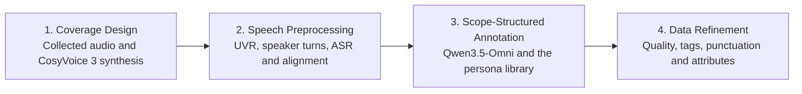

# VoxCaps

VoxCaps processes speech scenes in the four stages described in the paper. It keeps the original audio mixture for annotation and training. Separated vocals are used for speaker analysis, transcription and alignment.

## Workflow



| Stage | Processing | Code |
| --- | --- | --- |
| Coverage Design | Collect source records and synthesize elderly voices, short utterances and difficult pronunciations. Reading hints go to the teacher; student text stays in its original spelling. | [Source records](src/voxcaps/coverage_design/manifest.py), [synthesis](src/voxcaps/coverage_design/synthesis.py) |
| Speech Preprocessing | Separate vocals, identify speaker turns, transcribe with Fun-ASR-Nano and SenseVoice, then align words with Qwen3-ForcedAligner. | [Model calls](src/voxcaps/speech_preprocessing/models.py), [segmentation](src/voxcaps/speech_preprocessing/segmentation.py) |
| Scope-Structured Annotation | Describe Environment, Speakers and Content from the original mixture and transcript. Use the persona library for animation, drama and advertising. | [Annotator](src/voxcaps/scope_annotation/annotator.py), [prompts](src/voxcaps/scope_annotation/prompts.py), [style matrix](configs/03_scope_annotation/style_matrix.json) |
| Data Refinement | Filter by quality and duration, fix tags and punctuation, and extract gender, age, emotion and persona with supporting text. | [Quality gates](src/voxcaps/data_refinement/quality.py), [tag repair](src/voxcaps/data_refinement/tag_repair.py), [punctuation](src/voxcaps/data_refinement/description.py), [attributes](src/voxcaps/data_refinement/attributes.py) |

[Stage runners](src/voxcaps/stages.py) connect the four stages. Manual review and expressive-subset selection are outside this package.

## Run

Use Python 3.10 or later. Install the package and model dependencies, and install the [CosyVoice 3 runtime](https://github.com/QwenAudio/CosyVoice) separately.

```bash
python -m pip install -e '.[models]'
```

Follow [the model download and API setup](docs/models.md), then fill in the paths and endpoint in `configs/`. Qwen3.5-Omni uses a hosted streaming API; the other models run from downloaded weights. The API key is read from the configured environment variable. Input records use JSONL; see [the manifest format](docs/manifest.md).

```bash
voxcaps stage1 sources.jsonl --output outputs/stage1 \
  --teacher-dir models/Fun-CosyVoice3-0.5B
voxcaps stage2 outputs/stage1/manifest.jsonl --output outputs/stage2 \
  --config configs/02_speech_preprocessing/config.example.json
voxcaps stage3 outputs/stage2/manifest.jsonl --output outputs/stage3 \
  --config configs/03_scope_annotation/config.example.json
voxcaps stage4 outputs/stage3/manifest.jsonl --output outputs/stage4 \
  --config configs/04_data_refinement/config.example.json
```

Each stage writes a manifest for the next stage. Stage 4 writes `accepted.jsonl`, `rejected.jsonl` and `report.json`. Accepted records retain the original mixture as `waveform_target`, the three-part description, attributes and a record of corrections.

## Optional sorting

[The sorter](src/voxcaps/data_refinement/ranking.py) reads existing scores or preference pairs. Equal scores keep the same rank. Preference pairs produce an order consistent with the supplied relations; cyclic relations cause an error. Sorting does not change the accepted dataset.

```bash
voxcaps rank outputs/stage4/accepted.jsonl --score-field quality_score.mos
voxcaps rank examples/preferences.jsonl --mode preferences
```

## Tests

```bash
python -m unittest discover -s tests -v
```

The tests use cached metadata and mock model results. [Paper settings](docs/paper_alignment.md) and [upstream sources](THIRD_PARTY_NOTICES.md) are listed separately.
